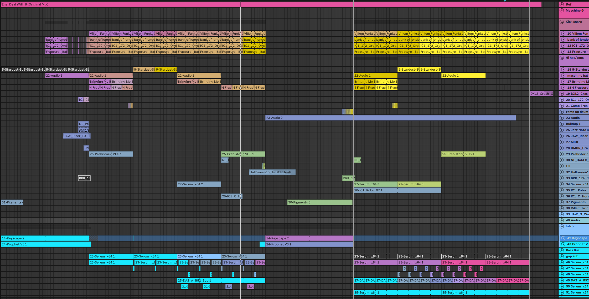
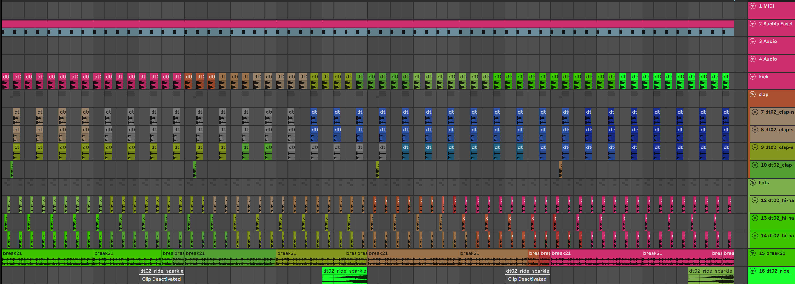

# Abletoolz

Abletoolz is a Python library and command line tool to edit, fix and analyze Ableton Live sets. Primarily the purpose is to automate things that aren't available in Live and make your life easier.

Maybe you've moved your samples, switched computers, or opened an old project and found half the plugins missing. Or you've bought a new audio interface and now every set sends its master output to the wrong place. You can work on one set or point abletoolz at a whole folder and fix them together.

It can:

- Build a database of your sample folders and use it to find missing samples in your sets. It stores the same checksum Live saves with its sample references, giving it more information to check a match.
- Check which plugins a set needs and whether Live can load them on this computer.
- Convert supported plugins between VST2, VST3 and Audio Units, or carry patches from certain older plugins into newer ones. Each conversion has to be mapped out first.
- Find and fix missing files inside supported plugins too, including samples, kits and instruments that Live's own missing-media search doesn't see.
- Set all your Master/Cue outputs to a specific output, so if you buy a new audio interface you can fix all your master outs to point to 7/8 in one go.
- Color your tracks/clips with random gradients, fold/unfold tracks, and set track heights and widths.
- Read and edit sets from Python, including MIDI notes, device settings and supported plugins' saved patches.
- Dump the XML of a set, in case you want to dissect how they are structured or contribute to this project : )

It works with Windows and macOS created sets, from Ableton 8.2 through Live 12 (not every operation works with every version). In-place edits keep a backup of the original, and ordinary saves preserve the set's modification time.

## Installation

Minimum Python required is [3.12](https://www.python.org/downloads/).

Open a command line shell and make sure Python is installed:

```bash
python -V  # Should give you Python 3.12 or newer
pip install abletoolz
```

This installs `abletoolz` as a command you can call from anywhere. Create an issue if you run into any errors please!

To run it from a clone of the repository, see [installing a development copy](doc/DEVELOPMENT.md#install-a-development-copy).

## Start with one set

Check its samples and plugins:

```bash
abletoolz "my song.als" --check-samples --check-plugins
```

Or use a folder to check all the sets inside it, including subfolders:

```bash
abletoolz "D:/sets" --check-samples --check-plugins
```

Sets inside `Backup` and `abletoolz_backup` folders are skipped. You can also pass several sets or folders in one command. The paths here are examples; use your own folders on Windows or macOS.

Checking doesn't change your set, though it does write [scan results](#what-a-run-leaves-behind). All editing flags only change the set in memory until you add `-s` / `--save`. Plugin conversion has its own explicit save step, `plugins apply` (or `plugins plan --apply`).

Use `-h` for the command's options. A run prints one short block per set: what it found, with problems named, then one line for the whole run. Add `-v` to list everything behind the counts, such as every relinked file, and to see diagnostics.

If you want to write your own scripts, the [Python tutorial](doc/LIBRARY.md) starts with opening a set and builds up one step at a time.

## Finding your samples again

First, point abletoolz at the folders where your samples might be. Include your project folders too:

```bash
abletoolz --db "D:/samples" "D:/sets" "C:/Users/Public/Documents"
```

The database stores filenames, sizes, dates and the same checksum Live saves with its sample references. Abletoolz uses the information available in the set to check candidate files. If it can't settle on a match, it leaves that reference alone and tells you why.

To fix missing references and collect the found audio into each project:

```bash
abletoolz "D:/sets" --fix-samples-collect -s
```

If you'd rather keep samples in your library, `--fix-samples-absolute` points the set at their full paths instead:

```bash
abletoolz "D:/sets" --fix-samples-absolute -s
```

### Samples and files inside plugins

Sample checks and fixes also look inside supported plugins' saved settings. This can find a missing sample in Serato Sample, or a Battery kit or Kontakt instrument, even when Live opens the set without reporting missing media.

To find replacements, you need to index the folders containing those files too. Include your Kontakt libraries, Maschine kits and user content, Battery kits, Reaktor ensembles, and any other folders holding files your supported plugins use. For example:

```bash
abletoolz --db "D:/samples" "D:/Kontakt Libraries" "D:/Maschine Content" "D:/Battery Kits" "D:/Reaktor Ensembles"
```

Use your own content-folder paths; those names are just examples. The scan includes their subfolders. If you've already indexed a parent folder containing these libraries, you don't need to list each one separately.

The same `--db` command builds two databases automatically: audio files go into the sample database, and recognized plugin-specific files go into `plugin_files.sqlite3` beside it. Those include Kontakt instruments (`.nki`), Maschine groups and sounds (`.mxgrp`, `.mxsnd`), Battery kits (`.nbkt`) and Reaktor ensembles (`.ens`). The plugin maps determine which file types are indexed.

You don't need a separate indexing command for plugin files. `--plugin-db` is different: it records installed plugins, not their sample libraries or kits. Point `--db` at the content folders, then run `--check-samples` and the sample-fixing commands as usual. Both databases are used automatically.

Support is per plugin and saved format: some references can be relinked, while others are only reported for you to fix by hand. This repairs references found in the plugin's state saved in the set; it doesn't recursively repair every file inside a kit or instrument library. See the [support table](#supported-plugins) for an overview.

Collecting copies found audio into the project. Files only a plugin loads, such as Kontakt instruments or Battery kits, are relinked where they are in your library and aren't copied.

### Keeping the database up to date

Run `--db` again whenever you add samples. It checks what's changed and reuses the checksums of unchanged files, so it doesn't have to read every sample again. Folders you don't pass stay in the database.

The database uses SQLite to look up matches without loading the entire catalog into memory. Checksum readers work in parallel when indexing, and sets are processed across your available CPU cores. Use `--db-workers N` to limit checksum readers and `-j N` to limit simultaneous sets; `-j 1` processes one set at a time.

Search your indexed files by file and folder names:

```bash
abletoolz --search-samples "kick 174"
```

If you always scan the same folders, put them in `config.yaml` and run `abletoolz --db` with no folders:

```yaml
file_database:
  paths:
    - "D:/samples"
    - "D:/sets"
    - "D:/Kontakt Libraries"
    - "D:/Maschine Content"
    - "D:/Battery Kits"
    - "D:/Reaktor Ensembles"
```

These folders populate both the sample and plugin-file databases. Add any other content folders your plugins use here too.

The config folder is `%APPDATA%\abletoolz` on Windows, `~/Library/Application Support/abletoolz` on macOS, or `~/.config/abletoolz` on Linux.

`--db-prune` removes database entries whose files no longer exist. Connect your sample drives first, since files on a disconnected drive count as gone too. Missing files are never used to repair a set, even before pruning.

## Converting plugins

Opening an old set can mean finding plugins you haven't had installed for years. Maybe you've upgraded them since, or they no longer run on your computer. Sharing projects can cause the same problem: your friend uses Audio Units and you use VSTs, even though you both have the same plugin.

Abletoolz can help recover those sets by converting supported devices to a plugin or format you can use, using the settings saved in the set as its starting point. That can mean switching formats, upgrading an old Pro-Q to Pro-Q 3, or rebuilding a Pro-53 patch in Prophet-5 V where some settings can only be approximated.

The difficult part is understanding those saved settings. Live stores a buffer of data supplied by the plugin inside the set, and each plugin decides how to encode its sounds and settings. VST2, VST3 and AU tell Live how to host a plugin, but don't give every plugin a common patch format. Abletoolz already handles Live's outer wrappers and several common state wrappers; the contents still need to be understood and checked for each plugin and version.

Sometimes the same patch can carry across with a different wrapper. Other conversions need individual settings translated, including their units and ranges. Automation adds another problem: the same knob can have a different parameter ID or value scale in another format or version. Restoring the patch doesn't automatically restore the automation that controlled it. The [conversion limits](#what-converting-costs) explain what currently gets removed or approximated.

That's why conversions are mapped out case by case. The plugins mapped so far are the ones in my own library, often because I wanted an old project working again, so they likely won't cover what's in yours. [Make a plan](#make-a-plan-check-it-then-apply) to see what abletoolz can do with your sets. To recover a plugin it can't convert, look for a newer version from its maker; if it's abandonware, you can try reverse engineering it with REA. Recognizing a plugin doesn't mean every format swap or upgrade is supported.

```bash
abletoolz --plugin-maps
```

That lists what abletoolz knows about each plugin, including which formats and operations it supports. If yours isn't covered, [you can help map it](#helping-add-your-own-plugins).

### Supported plugins

This is a short overview of the implementations checked on 2026-11-02. New maps may reach the code before this table is updated, and an older installed release may support less. Run `abletoolz --plugin-maps` for your version's catalog, then make a plan to see what it can do with your actual patches.

Arrows show implemented directions, not every format the plugin itself ships in. “None” means no format swap or further converter is listed here; recognition or state editing may still be supported. File repair is limited to the formats mapped for that plugin. A listed conversion can still have version limits or warnings, including the automation losses described below.

| Plugin | Same-plugin format swaps | Upgrade / other converter | Files inside its saved patch |
| --- | --- | --- | --- |
| AAS Lounge Lizard EP-4, Lounge Lizard 3 | None | → Spectrasonics Keyscape Rhodes - Classic VST3 or VST2 (approximations) | — |
| Akai MPC Essentials | None | None | Report project references; manual repair |
| Arturia minimoog V Original | None | → Mini V3 VST3 or VST2 | — |
| Arturia CS-80V, CS-80 V2 | None | → CS-80 V3 VST3 or VST2 | — |
| Arturia Piano V2, Wurli V2, ARP 2600 V2, Prophet V2, Modular V2 | None | → their V3 VST3 or VST2 | — |
| Arturia Analog Lab 3, Analog Lab 4 | None | → Analog Lab V VST2 | — |
| Arturia Mini V3, Prophet V3, Prophet-5 V, MS-20 V, CS-80 V3 | VST2 ↔ VST3; CS-80 V3: AU → VST3 or VST2, VST2 → AU | None | — |
| Arturia Chorus JUN-6, Dist TUBE-CULTURE | VST3 ↔ AU | None | — |
| Arturia CMI V | None | None | Relink samples |
| Audio Damage Ratshack Reverb 2, DubStation 1.5, Discord 3 | None | None; mapped | — |
| Camel Audio CamelPhat 3 | None | None; mapped | — |
| Devious Machines Texture | VST2 ↔ VST3 | None | Relink samples |
| FabFilter Pro-Q, Pro-Q 2 | None | → Pro-Q 3 VST3 or VST2 | — |
| FabFilter Pro-C (including SC), Pro-L | None | → Pro-C 2 / Pro-L 2 VST3 or VST2, respectively | — |
| FabFilter Saturn, Volcano 2 | None | → Saturn 2 / Volcano 3 VST3 or VST2, respectively | — |
| FabFilter Timeless 2 | VST2 ↔ VST3 | → Timeless 3 VST3 or VST2 | — |
| FabFilter Pro-C 2, Pro-DS, Pro-G, Pro-L 2, Pro-MB, Pro-Q 3, Saturn 2, Timeless 3, Volcano 3 | VST2 ↔ VST3; Pro-C 2: AU → VST3 or VST2, VST2 → AU | None | — |
| Goodhertz Tupe 3 | VST2 ↔ VST3 | None | — |
| iZotope Ozone 8 Elements | None | → Ozone 9 VST2 | — |
| iZotope Stutter Edit 2 | VST2 ↔ VST3 | None | — |
| iZotope Iris | None | None | Report sample references; manual repair |
| iZotope Trash | None | → Trash 2 VST2 | — |
| iZotope Ozone 9 Exciter | None | None; mapped state, VST3 writing incomplete | — |
| Kilohearts kHs effects (listed below) | VST2 ↔ VST3 | None | — |
| KORG MS-20, Legacy Cell | None | → Arturia MS-20 V VST3 or VST2 (experimental) | — |
| KORG MDE-X, Polysix, WAVESTATION | None | None; recognized only | — |
| Native Instruments Absynth 3 | None | → Absynth 5 VST2 | — |
| Native Instruments Pro-53 | None | → Arturia Prophet-5 V VST3 or VST2 (approximations) | — |
| Native Instruments Battery 4 | None | None | Relink samples and kits |
| Native Instruments Kontakt 5, Kontakt 5 16out | None | None | Relink mapped instrument/library references |
| Native Instruments Maschine 2, Maschine 2 FX | None | None | Relink samples, groups and sounds |
| Native Instruments Reaktor 6 | None | None | Relink ensemble references |
| Native Instruments Massive | None | None; mapped state, VST3 writing incomplete | — |
| Ohm Force Ohmicide | None | → Ohmicide[S] VST3 or VST2 | — |
| Serato Sample | VST2 ↔ VST3 | None | Relink samples |
| Sonimus Satson Channel | None | None; mapped | — |
| Subsonic Labs Wolfram | None | None; mapped | — |
| Surge | None | → Surge XT VST3 / AU | — |
| Surge XT, Surge XT Effects | VST3 ↔ AU | None | — |
| Twin Delay | None | None; mapped | — |
| u-he Podolski | VST2 ↔ VST3 | None | — |
| Valhalla Delay, FreqEcho, Plate, Room, Shimmer, Supermassive | Between VST2, VST3 and AU, any direction | None | — |
| xfadelooper | None | None | Relink samples |
| Xfer Serum | VST2 ↔ VST3; AU → VST2 or VST3 | → Serum 2 VST3 / AU (experimental) | — |
| Xfer Serum 2 | VST3 ↔ AU | None | Relink samples and referenced images |

The kHs effects covered are 3-Band EQ, Bitcrush, Channel Mixer, Chorus, Clipper, Comb Filter, Compactor, Compressor, Convolver, Delay, Distortion, Dual Delay, Dynamics, Ensemble, Filter, Flanger, Formant Filter, Frequency Shifter, Gain, Gate, Haas, Ladder Filter, Limiter, Nonlinear Filter, Phase Distortion, Phaser, Pitch Shifter, Resonator, Reverb, Reverser, Ring Mod, Shaper, Stereo, Tape Stop, Trance Gate and Transient Shaper. Evidence varies across these maps; a listed implementation is not a claim that every patch has been auditioned.

### Make a plan, check it, then apply

First record the plugins installed on this computer. Run this again after installing or removing plugins:

```bash
abletoolz --plugin-db
```

Extra plugin folders go in `config.yaml`:

```yaml
plugin_database:
  paths:
    - "D:/VstPlugins"
```

Make a plan for one set, or pass a folder to plan a whole library:

```bash
abletoolz plugins plan "my song.als" -o plan.yaml
```

This reads the sets and writes `plan.yaml`, without changing the sets. Each plugin appears once per format, with comments listing what it can become and what each conversion would lose. The last line it prints says how many of the plugins that don't load here have a target. Expect many to have none: only the plugins in the [support table](#supported-plugins) are mapped so far.

For every plugin that doesn't load here, `convert_to` is already filled in with what it can become on this computer, best first: the same plugin in another format before a different plugin, VST3 before VST2, and only plugins you have installed. Each device takes the first one it can, so a set too old for the VST3 gets the VST2. A plugin with nothing installed to become stays `null`, which means leave it alone:

```yaml
- plugin: FabFilter Pro-Q 2
  format: VST2
  convert_to: [pro_q_3_vst3, pro_q_3_vst2]
```

Change the list with the names in the comment above a plugin, or set it to `null` to keep that plugin as it is. Then apply:

```bash
abletoolz plugins apply plan.yaml
```

This saves the changed sets in place and copies the originals to `abletoolz_backup` first. One choice applies to every instance of that plugin and format in the planned sets. Apply reads the sets again; devices it can't convert stay as they were, with the reason. Add `--json` for structured results.

A plan file that already exists isn't overwritten unless you pass `--force`. Open the result in Live and listen before deleting its backup.

To skip checking the file, `abletoolz plugins plan "D:/Ableton Projects" --apply` writes the plan and applies its suggestions straight away.

### Convert for another computer

A plugin that loads here is in the plan too, left at `null`. Its comment also lists formats marked "not installed here", which you can pick for a computer that has them, such as the AU when you give a set to a friend on a Mac:

```yaml
- plugin: Chorus JUN-6
  format: VST3
  convert_to: chorus_jun_6_au
```

Apply it the same way. The other computer still needs the plugin installed.

### What converting costs

A saved patch and Live's automation are separate things. Even when a patch carries over, a converted device currently loses its automation and clip envelopes, MIDI and macro mappings, because the target's controls can have different numbers. Its configured control list is rebuilt where supported, or left empty.

Upgrades can also leave out or approximate settings the target has no equivalent for. The plan shows these costs before you apply, and the result repeats them for each affected device. Some conversions are experimental; the plan's evidence and warnings matter even when a conversion succeeds.

### A few common cases

- **An older set:** Live 9 and 10.0 sets can't hold a VST3, so abletoolz moves such a set up to Live 10.1's format when it writes one, and the plan lists what that changes. A Live 9.0 set using some of Live's own devices can't be moved; open and save it in a newer Live first.
- **Old wrapped VST2 plugins:** `abletoolz plugins routes` lists measured recovery routes and the binaries found for them. Use `--plugin-dir "D:/VstPlugins"` to restrict the recovery-file search to that folder.
- **Missing samples as well as plugins:** fix and save the sample references first, then make the conversion plan. Converting a patch doesn't relink its files.

The [Python tutorial](doc/LIBRARY.md#8-check-and-convert-plugins) shows how to inspect targets, choose by your own rules, keep individual devices unchanged and write converted copies elsewhere.

## Other things you can do

Set all master outs to stereo 1/2 and cue outs to 3/4:

```bash
abletoolz "D:/sets" --master-out 1 --cue-out 2 -s
```

The output numbers count stereo pairs: `1` is 1/2, `2` is 3/4, and so on.

`--gradient-tracks` generates random gradients for tracks and clips. There are only 70 colors in Ableton's palette, but sometimes you get some pretty good results!



`--fold` / `--unfold` folds or unfolds tracks. `--set-track-heights` changes arrangement heights, including groups and automation lanes; `--set-track-widths` changes Session View widths. Try a few values on one set first, since how they look depends on your display. On my setup, 68 is the default track height and 24 the default width.

You can combine edits:

```bash
abletoolz "my song.als" --unfold --set-track-heights 68 --set-track-widths 24 -s
```

`--list-tracks` lists track information. `-x` / `--xml` writes the uncompressed set XML beside the set, which is useful for exploring its structure. Live can also open uncompressed XML renamed to `.als`, provided the document is valid.

## Saving your changes

`-s` / `--save` saves ordinary edits in the original location. Before replacing a set, abletoolz copies it to `abletoolz_backup/set_name__1.als` beside the original. If that name exists, it uses `__2`, then `__3`, so earlier backups are kept. A set the run doesn't change isn't written.

To write repaired copies into another folder instead:

```bash
abletoolz "D:/sets" --fix-samples-absolute -s --output "D:/repaired_sets"
```

The originals stay where they are. `--fix-samples-collect` can't be combined with `--output`, because collecting targets each original project's sample folder. With `-x`, the XML goes into the output folder too; repeated XML exports keep numbered backups.

Because I understand how many hours of hard work go into set files, I've put safeguards around saving. In-place saves keep the backup, and the replacement is written to a temporary file before being swapped into place. Still, experiment on a set you don't care about first and open the result in Live before running edits over hundreds of projects.

`plugins apply` saves directly with backups; it doesn't need `-s`. To choose another destination for plugin conversions, use the [Python copy example](doc/LIBRARY.md#write-converted-copies-somewhere-else).

## Undoing a save

Every time abletoolz saves over a set, it keeps the old version in `abletoolz_backup` and remembers which command saved it. To put back what the last command changed:

```bash
abletoolz undo
```

It lists each set, the backup it would come back from and when that version was last saved, then asks before changing anything. Check the dates: an old one means you'd be going back further than you might think. The version it replaces goes into `abletoolz_backup` too, so nothing is lost. Undo puts back sets only: samples `--fix-samples-collect` copied into a project stay there.

```bash
abletoolz undo 3          # the last three commands
abletoolz undo --list     # every command that can be undone
abletoolz undo --trim 5   # keep each set's 5 newest backups, delete the older ones
```

A set you've changed since is pointed out before you answer. If a backup was deleted, that set is left as it is and the rest are still restored. Trimming asks first, and the backups it deletes are gone for good; it covers the sets abletoolz has saved since undo existed.

## What a run leaves behind

A run that checks or fixes samples or plugins leaves a small `<set name>.meta.yaml` beside each set (`<clip name>.alc.meta.yaml` for a clip). The `status` and `notes` fields are yours to fill in; abletoolz leaves them alone:

```yaml
status: needs work
notes: reverb tail runs long in the breakdown
scan:
  live_version: Ableton Live 11.3.42
  bars: 128
  bpm: 174.0
  plugins_missing:
    Serum_x64: 2
  samples_missing: 3
```

The real file has a few more fields to tell whether the scan needs refreshing. Plugin-only checks can reuse results for an unchanged set when the relevant configuration and plugin information also agree. Sample checks always look at your drives. `--no-meta` skips these files and checks fresh.

Set-processing runs also write `abletoolz_report_<timestamp>.json` with what they found, changed and couldn't do. The [Python tutorial](doc/LIBRARY.md#read-what-a-scan-found) shows how to read a saved scan.

## Using it from Python

Everything the command line does, you can call from Python:

```python
from pathlib import Path

from abletoolz.live_set import AbletonSet

song = AbletonSet(Path("my song.als"))
if not song.parse():
    raise ValueError("Couldn't read the set; see the log for why")
print(song.version, song.transport.bpm(), "bpm")
for track in song.tracks.load():
    print(track.name)
```

[Using abletoolz as a library](doc/LIBRARY.md) starts there and works up to fixing samples, editing notes and settings, converting plugins and reading their saved patches. You can follow it entirely in Python.

## Experimental: JSON for programs

`--describe structure|patterns|full` reads a set as JSON. `patterns` includes clips and notes:

```bash
abletoolz "tune.als" --describe patterns
```

`--apply-ops` applies a JSON document of edits to a new set. Its `--output` is a filename, unlike the directory used with ordinary `-s` edits:

```bash
abletoolz "tune.als" --apply-ops edits.json --output "tune variation.als"
```

The input set is left alone. See [JSON for programs](doc/LIBRARY.md#experimental-json-for-programs) for an example and the supported operations. This interface may still change.

## Helping add your own plugins

If your plugin isn't supported yet, you can help map it out : )

Abletoolz already handles how Live carries VST2, VST3 and Audio Unit devices, and several common wrappers around their patches. The remaining work depends on the plugin: its identity, how it saves settings, and whether those settings carry across formats or versions.

A useful starting point is to save a patch, change one control and compare another save. For upgrades, try importing old presets into the newer plugin and saving them there. Those pairs show how the plugin itself translates its settings.

For a plugin whose maker is gone, see [salvaging an old plugin](doc/DEVELOPMENT.md#salvaging-an-old-plugin). The [plugin mapping walkthrough](doc/DEVELOPMENT.md#mapping-a-new-plugin) covers these experiments, using DawDreamer or Pedalboard to automate them, and investigating unfamiliar formats with Ghidra. Mapping a sample path or one format swap is useful too; you don't have to decode every control before contributing.

## Development and future work

[Developing abletoolz](doc/DEVELOPMENT.md) explains the code layout and how to contribute. Plugin data and test fixtures use Git LFS, so install it before cloning.

Some things still need work:

- More plugin maps, conversions and support for carrying automation across them.
- Making copies for older Live versions reliable. Python's `save_as` is experimental and some copies still crash Live.
- More ways for scripts and other programs to work with sets.

`--dump-plugins` and `-x` help inspect plugin settings and set XML. `abletoolz-dj-crates` builds pre-warped `.alc` clips from a TSV of track analysis; run `abletoolz-dj-crates --help` for its options.
